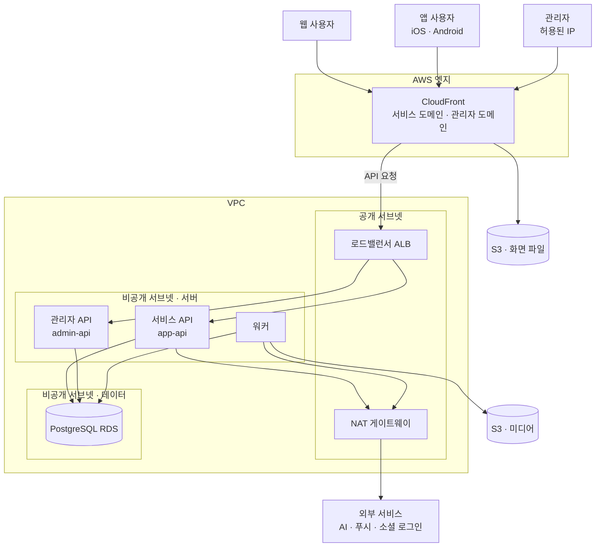

# 아키텍처

JUST SHOOT을 하나의 Node 프로젝트에서 저장소 4개로 나눠 다시 만든다. 이 문서는 결론만 담는다. 이유는 `결정기록.md`에 있다.

표의 상태가 **확정**이면 사용자가 정한 것이고, **제안**이면 반대가 없을 때 그대로 진행할 권장안이다.

## 저장소

| 저장소 | 담는 것 | 배포되는 것 | 상태 |
| --- | --- | --- | --- |
| `unlimited-x-docs` | 설계, 결정, 지시서, 보고서 | 없음 | 확정 |
| `unlimited-x-api` | 서버 전체와 API 계약, DB 변경 이력 | 서비스 API, 관리자 API, 워커 | 확정 |
| `unlimited-x-web` | 사용자 화면과 iOS·Android 앱 껍데기 | 웹사이트, App Store 앱, Google Play 앱 | 확정 |
| `unlimited-x-admin` | 관리자 화면 | 관리자 사이트 | 확정 |

## 기술 스택

| 영역 | 선택 | 상태 |
| --- | --- | --- |
| 서버 언어·프레임워크 | Java + Spring Boot | 확정 |
| DB | PostgreSQL | 확정 |
| 미디어 저장 | AWS S3 | 확정 |
| 프런트 (web, admin) | TypeScript + React + Vite | 확정 |
| 모바일 | web을 Capacitor로 감싸 Android·iOS 지원 | 확정 |
| 실행 환경 | 로컬은 Docker, 개발·운영은 AWS | 확정 |
| 서버 구성 | Gradle 멀티모듈: `core`, `app-api`, `admin-api`, `worker` | 제안 |
| DB 변경 관리 | Flyway. `core`만 스키마를 바꾼다 | 제안 |
| DB 접근 | Spring Data JPA, 복잡한 조회는 JdbcClient로 직접 SQL | 제안 |
| 인증 | 짧은 액세스 토큰(JWT) + DB에 저장하는 회전식 리프레시 토큰 | 제안 |
| 소셜 로그인 | Google + Apple | 제안 |
| API 계약 | OpenAPI 파일(`app`, `admin`)을 api 저장소에 두고 프런트 클라이언트를 자동 생성 | 제안 |
| 파일 업로드 | 사전 서명 URL로 클라이언트가 S3에 직접 업로드 | 제안 |
| 비동기 작업 | PostgreSQL 테이블 큐를 읽는 워커 | 제안 |
| 푸시 | Firebase Cloud Messaging | 제안 |
| 서버 테스트 | JUnit + Testcontainers | 제안 |
| web 상태·연동 | TanStack Query + 계약에서 생성한 클라이언트 | 제안 |
| web 스타일·다국어 | Tailwind CSS, i18next (한·영·일·중) | 제안 |
| web 테스트 | Vitest, Playwright | 제안 |
| admin 화면 구성 | Ant Design | 제안 |

버전은 각 저장소를 만드는 시점의 최신 안정판으로 고정한다.

## 서버 모듈

| 모듈 | 역할 |
| --- | --- |
| `core` | 도메인, 엔티티, 서비스, DB 마이그레이션. 스키마의 유일한 주인 |
| `app-api` | web과 모바일 앱이 쓰는 공개 API |
| `admin-api` | 관리자 화면이 쓰는 API. IP 제한과 별도 로그인을 건다 |
| `worker` | 영상 변환, AI 생성 같은 오래 걸리는 작업 |

`app-api`, `admin-api`, `worker`는 각각 따로 배포한다. 코드는 한 저장소에 둔다.

## 비동기 작업 흐름

1. 클라이언트가 `app-api`에 작업을 요청하면 서버는 작업 번호를 바로 돌려준다.
2. 작업은 PostgreSQL 테이블에 대기 상태로 저장된다.
3. `worker`가 작업을 꺼내 실행하고 상태를 갱신한다.
4. 클라이언트는 작업 번호로 상태를 조회하거나 푸시로 완료를 받는다.

슛 차감은 요청 시 예약, 성공 시 확정, 실패 시 반환으로 처리한다. 같은 요청이 두 번 와도 한 번만 차감한다.

## 네트워크 구성 (제안)

AWS를 쓰는 것은 확정이고, 아래 세부 서비스 구성은 제안이다. 개발용과 운영용 환경을 같은 구조로 따로 둔다.

- 서버, 워커, DB는 인터넷에서 직접 접근할 수 없다. 밖으로 나가는 통신만 NAT를 통해 허용한다.
- 영상과 이미지는 사용자가 S3에 직접 올리고 CloudFront로 내려받는다.
- 관리자 사이트와 관리자 API는 허용된 IP에서만 열리고, 로그인에 2단계 인증을 적용한다.

## 기존 서비스에서 가져오는 것

- 사진 누끼, 보정, 카드·포스터 합성 로직은 브라우저에서 동작하므로 web으로 그대로 옮긴다. 재설계하지 않는다.
- 4개 언어 문구 사전을 변환해 옮긴다.
- 기존 계정은 비밀번호를 다시 만들지 않고 로그인할 수 있게 한다. 기존 scrypt 해시를 검증하고, 로그인에 성공하면 새 방식으로 바꾼다.
- 선수 ID, 기록, 게시물, 팬 관계를 보존한다.

## 미리 반영할 조건

- API 주소에 버전(`/v1`)을 넣는다. 모바일 앱은 옛 버전이 남으므로 최소 지원 버전 확인 기능을 둔다.
- 링크 공유 미리보기는 정적 빌드로는 뜨지 않는다. 공유용 주소는 api가 미리보기 태그가 담긴 HTML을 내려준다.
- iOS 심사 조건: 앱 고유 기능(푸시·공유·카메라), 앱 안 계정 삭제, 신고·차단, Apple 로그인.
- 슛을 실제로 팔게 되면 앱 안에서는 인앱결제를 써야 한다. 원장은 결제 수단을 바꿔 끼울 수 있게 설계한다.
